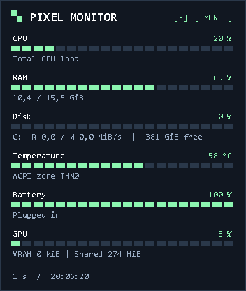
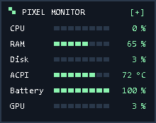

# Pixel Monitor

Pixel-style desktop widget for monitoring local AI workloads on Windows 11. It shows CPU, RAM, GPU, dedicated and shared GPU memory, disk, battery and ACPI temperature.

[Download the portable Windows ZIP](https://github.com/sedoussiagh/pixelWidget/releases/latest)

 

## Quick start

Extract the whole ZIP and run **PixelMonitor.exe**. The portable build needs no administrator rights or third-party driver. To compile from source and create desktop and Start menu shortcuts, run:

```powershell
powershell.exe -NoProfile -ExecutionPolicy Bypass -File .\Install.ps1
```

## Monitor an AI workload

- **GPU adapter** selects a Windows adapter identifier. Automatic mode follows the busiest adapter. Load is the busiest engine on that adapter. Dedicated and shared GPU memory are shown separately.
- **AI session → Start CSV recording** saves readings directly to a local CSV. **Stop and show peaks** displays duration, sample count and observed peaks.
- **History (60 samples)** switches from instantaneous bars to recent readings. **Alerts** offers CPU, RAM and ACPI temperature thresholds.
- **[-]** and **[+]** switch between full and compact views. Both have a right-click menu. English is the default, with French and right-to-left Arabic available under **Language**.
- **About** shows the adapter and thermal-zone identifiers when available.

## Compatibility

Tested on a ThinkPad T480s with Windows 11 Pro 23H2 x64 and Intel integrated graphics. ARM64, other Windows versions and discrete GPUs have not been validated. Windows in S mode cannot run the portable build.

GPU counters depend on Windows and the graphics driver. Missing readings appear as `--`. ACPI temperature reports the hottest zone Windows exposes. Its reading may differ from CPU Package temperature. Preferences stay under `%LOCALAPPDATA%\PixelMonitor`, and session CSVs go to the location you choose.

[MIT license](LICENSE)
